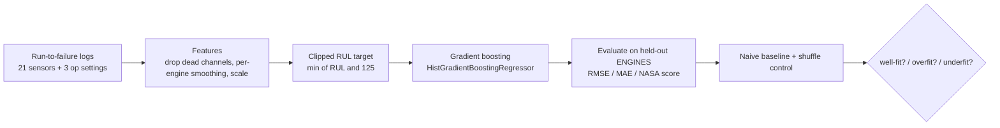

# RotorWatch

**Predictive maintenance for rotating equipment: estimating Remaining Useful Life from sensor data.**

RotorWatch estimates how many operating cycles a machine has left before it fails — its
**Remaining Useful Life (RUL)** — from the sensor and operating-setting streams that any
monitored rotating asset already produces. It is built and validated on the **NASA
C-MAPSS** turbofan run-to-failure benchmark, the canonical public dataset for prognostics,
and it does the parts that separate a real result from a flattering one: it holds out
**whole engines** for test, cross-validates grouped by engine, uses the documented
**clipped-RUL** target, and proves the model learns real wear signal with a shuffled-label
control.

> The oil & gas reading: an "engine" here is any monitored rotating machine on a platform
> — a gas-turbine driver, a centrifugal compressor, a crude-export or water-injection
> pump. The same method estimates running hours (or cycles) to failure from that machine's
> vibration, temperature, pressure, and flow channels, turning run-to-failure history into
> a maintenance lead time.

[](.github/workflows/ci.yml)
[](pyproject.toml)
[](LICENSE)

---

## Why it exists

Unplanned failure of rotating equipment is one of the most expensive events in heavy
industry: lost production, secondary damage, and — offshore — a safety problem. Maintenance
built purely on fixed calendars either services healthy machines too early or misses the
ones that are degrading. **Predictive maintenance** replaces the calendar with a
data-driven lead time: watch the sensors, estimate how much life remains, and schedule the
intervention for the right machine at the right time. RUL estimation is the core of that
loop, and C-MAPSS is the standard proving ground for it.

## What it does

* Loads the real C-MAPSS FD001 fleet (100 engines run to failure, 20,631 cycles).
* Builds leakage-free tabular features: drops the dead sensor channels, denoises each
  channel with a per-engine rolling mean, and standardises.
* Regresses the **clipped RUL** target with a gradient-boosting model.
* Evaluates on **engines the model never saw**, against a naive baseline and a shuffled-label
  control, and classifies the fit as well-fit / overfit / underfit.

## How it works



## Quickstart

```bash
python -m venv .venv && source .venv/bin/activate
pip install -e ".[dev]"

python -m rotorwatch.cli demo        # fast, synthetic fleet — the method end to end
python -m rotorwatch.real_benchmark  # the full benchmark on the real C-MAPSS data
pytest                               # the test suite
```

The two load-bearing ideas, each with its own reason:

### 1. Split by engine, never by row (the leakage trap)

Consecutive cycles of the same engine are almost identical. If any cycle of an engine is in
the training set, a model can effectively look up the answer for that engine's other
cycles, and a **random row split** reports a wonderful number that collapses in the field.
RotorWatch holds out **whole engines** and cross-validates with `GroupKFold` grouped by
engine, so no engine is ever on both sides of a split. The benchmark asserts the train and
test engine sets are disjoint before it reports anything.

### 2. Clip the RUL target (the documented method)

Early in an engine's life the sensors look healthy and RUL is simply not predictable from
them — a machine 300 cycles from failure and one 200 cycles from failure look the same.
Training on those exact numbers only injects label noise. The standard C-MAPSS target is a
**piecewise-linear RUL**: held flat at a cap (here **125**) while true RUL is above it, then
decreasing linearly to 0 at failure. This is the documented practice in the C-MAPSS
literature, and it asks the model the answerable question — *is failure near, and how
near?*

## The model

A `HistGradientBoostingRegressor` (scikit-learn) on the tabular sensor features. Gradient
boosting fits the RUL signal — non-linear, interacting thresholds across noisy channels —
directly and fast, with built-in regularisation (a learning rate, a leaf cap, an L2
penalty, a floor on samples per leaf) that keeps it from memorising individual engines.
Three metrics are reported:

* **RMSE** and **MAE** in cycles.
* The **NASA score** — the asymmetric scoring function from the PHM08 C-MAPSS challenge,
  which penalises *late* predictions (the model thinks more life remains than there is —
  you run a failing machine) more than *early* ones (you service too soon). That asymmetry
  is the maintenance cost trade-off, so it is the metric the field reports.

## Results on real C-MAPSS data

Run `python -m rotorwatch.real_benchmark` (reproducible, `seed=0`):

```
engines            : 100 (80 train / 20 held-out), 20631 cycles, 34 features, RUL cap 125

                           RMSE      MAE   NASA score
held-out engines         20.050   14.072     117318.5
grouped CV (mean)        18.685   13.059      62265.2
train engines            11.903    8.390            -
naive-mean baseline      41.980   36.817    1349753.7
shuffle control          41.800   36.470    1577197.9

train/held-out RMSE gap : +8.147   held-out vs CV agreement: 7.3%   CV RMSE std: 2.064
verdict: well-fit
```

On engines it never trained on, the model estimates remaining life to within about **20
cycles RMSE / 14 cycles MAE** — less than **half** the naive-mean baseline's 42-cycle
error, and a NASA score more than **10×** better. The result stands on three checks:

- **It generalises, and it is stable.** The held-out error (20.1) tracks the grouped-CV
  estimate (18.7) to within 7.3%, so it is a property of the method, not a lucky split. The
  training error is lower (11.9) because a gradient-boosting ensemble naturally fits the
  training engines tightly; with an **engine-disjoint** evaluation the right test of
  generalisation is *held-out agrees with CV*, which it does — not a zero train/held-out
  gap. The model is deliberately not crippled to shrink that gap.
- **It clears the floor.** The naive-mean baseline (predict the average training RUL for
  everything) is the error a model must beat to be worth anything; RotorWatch roughly halves
  it.
- **The signal is real.** Retraining with the RUL labels **permuted** destroys the
  sensor→wear relationship, and the error collapses straight back to the baseline (41.8 vs
  the baseline's 42.0). A pipeline that "worked" on shuffled labels would be measuring
  leakage; this one measures learned degradation.

`python -m rotorwatch.cli demo` runs the same machinery on a synthetic fleet whose wear
signal is injected on purpose, as a fast, network-free demonstration that the pipeline
recovers a known signal (and that shuffling it away collapses the model).

## Project layout

```
rotorwatch/
  data.py           synthetic run-to-failure generator (known signal, for fast tests/demo)
  real_data.py      fetch + load the real NASA C-MAPSS FD001 data
  features.py       sensor selection, RUL clipping, per-engine smoothing, scaling
  model.py          the RUL regressor + metrics (RMSE, MAE, NASA score)
  real_benchmark.py engine-disjoint split + grouped CV + baseline + shuffle control + verdict
  cli.py            `demo` and `benchmark` commands
```

## Testing and quality

* **39 tests** cover the loader and fetch/paging path, the run-to-failure target, feature
  selection and leakage-free smoothing, the metrics and the NASA asymmetry, the
  engine-disjoint split and grouped CV, the beats-naive and shuffle-collapse results, and
  the verdict classifier. Each test was mutation-checked (it fails when the behaviour it
  guards is broken). CI requires at least **85%** coverage; the suite reaches ~98%.
* `ruff` for lint; both `ruff check` and `pytest` run green in CI on Python 3.13.

See the Spanish study guide in [`docs/estudio/`](docs/estudio/) for the full reasoning,
formulas, and a worked example with these numbers.

## Notes

The benchmark holds out complete run-to-failure engines and scores RUL at **every cycle**
of them. The original PHM08 competition instead truncates each test engine at a random
point and scores the single last-cycle prediction; the asymmetric NASA score here is summed
over the held-out per-cycle instances, which keeps it comparable across the model, the
baseline, and the control (they share the same instances). In a production deployment the
sensor feed would be the live historian stream for a specific asset class, and the cap
would be tuned to how far ahead that machine's degradation becomes observable.

## License

[MIT](LICENSE) © Angelo David Padilla Romero
